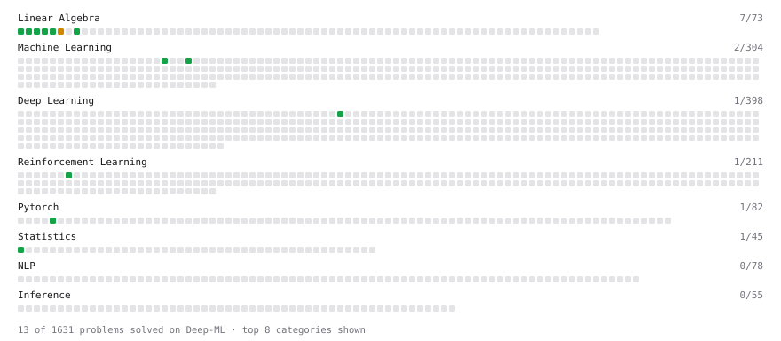

# Deep-ML

My machine learning practice from [Deep-ML](https://www.deep-ml.com). Every solution here was written by hand.

**18** solved · 18 problems · 0 labs · 0 math

[**Browse the interactive portfolio**](https://MHaurel.github.io/deep-ml/) to replay this filling in over time.

## Problems

| | Difficulty | Solved | |
| --- | --- | --- | --- |
| [Adagrad Optimizer](https://www.deep-ml.com/problems/145) | easy | 2026-10-21 | [solution](problems/0145-adagrad-optimizer) |
| [Add Positional Embeddings to Token Embeddings](https://www.deep-ml.com/problems/946) | easy | 2026-10-23 | [solution](problems/0946-add-positional-embeddings-to-token-embeddings) |
| [Calculate 2x2 Matrix Inverse](https://www.deep-ml.com/problems/8) | easy | 2026-10-21 | [solution](problems/0008-calculate-2x2-matrix-inverse) |
| [Calculate Covariance Matrix](https://www.deep-ml.com/problems/10) | easy | 2026-10-20 | [solution](problems/0010-calculate-covariance-matrix) |
| [Calculate Mean by Row or Column](https://www.deep-ml.com/problems/4) | easy | 2026-10-20 | [solution](problems/0004-calculate-mean-by-row-or-column) |
| [Compute a Gradient with PyTorch Autograd](https://www.deep-ml.com/problems/884) | easy | 2026-10-21 | [solution](problems/0884-compute-a-gradient-with-pytorch-autograd) |
| [Implement Precision Metric](https://www.deep-ml.com/problems/46) | easy | 2026-10-21 | [solution](problems/0046-implement-precision-metric) |
| [Implement Recall Metric in Binary Classification](https://www.deep-ml.com/problems/52) | easy | 2026-10-21 | [solution](problems/0052-implement-recall-metric-in-binary-classification) |
| [Incremental Mean for Online Reward Estimation](https://www.deep-ml.com/problems/159) | easy | 2026-10-19 | [solution](problems/0159-incremental-mean-for-online-reward-estimation) |
| [Matrix-Vector Dot Product](https://www.deep-ml.com/problems/1) | easy | 2026-10-19 | [solution](problems/0001-matrix-vector-dot-product) |
| [Optimal Policy Extraction from Q-Values](https://www.deep-ml.com/problems/466) | easy | 2026-10-23 | [solution](problems/0466-optimal-policy-extraction-from-q-values) |
| [Reshape Matrix](https://www.deep-ml.com/problems/3) | easy | 2026-10-20 | [solution](problems/0003-reshape-matrix) |
| [Scalar Multiplication of a Matrix](https://www.deep-ml.com/problems/5) | easy | 2026-10-20 | [solution](problems/0005-scalar-multiplication-of-a-matrix) |
| [Sort results with ORDER BY](https://www.deep-ml.com/problems/1104) | easy | 2026-10-25 | [solution](problems/1104-sort-results-with-order-by) |
| [Tinygrad: Backprop a Linear Layer by Hand](https://www.deep-ml.com/problems/919) | easy | 2026-10-24 | [solution](problems/0919-tinygrad-backprop-a-linear-layer-by-hand) |
| [Transpose of a Matrix](https://www.deep-ml.com/problems/2) | easy | 2026-10-20 | [solution](problems/0002-transpose-of-a-matrix) |
| [Calculate Eigenvalues of a Matrix](https://www.deep-ml.com/problems/6) | medium | 2026-10-20 | [solution](problems/0006-calculate-eigenvalues-of-a-matrix) |
| [Monthly Search Counts per Category with Join](https://www.deep-ml.com/problems/1241) | medium | 2026-10-21 | [solution](problems/1241-monthly-search-counts-per-category-with-join) |

---

_This file is regenerated by Deep-ML on every push._
